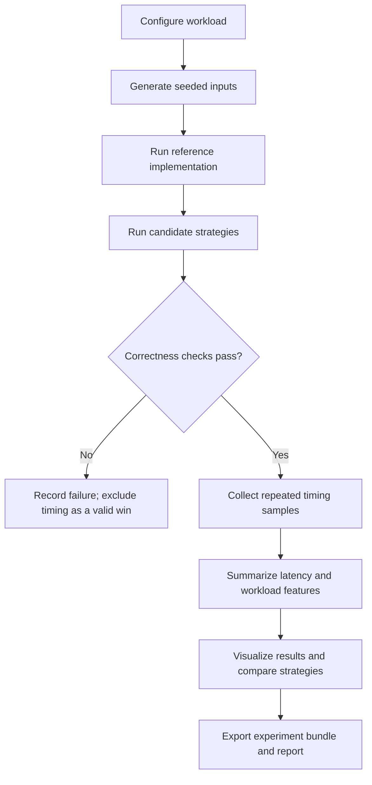

<div align="center">

# VoxelPool Explorer

### An interactive research lab for voxel-pooling performance, correctness, and workload-aware strategy selection.

<p>
  
</p>

<p>
  
  
  
  
  
</p>

<p>
  <a href="#quick-start">Quick start</a> ·
  <a href="#features">Features</a> ·
  <a href="#research-question">Research question</a> ·
  <a href="#methodology">Methodology</a> ·
  <a href="#reproducibility">Reproducibility</a> ·
  <a href="DEPLOYMENT.md">Deployment</a>
</p>

**VoxelPool Explorer turns voxel-pooling experiments into something you can inspect, compare, and reproduce.**

</div>

---

## At a glance

VoxelPool Explorer is a CPU-first research prototype for exploring how workload characteristics affect the behavior of voxel-pooling accumulation strategies. It combines an interactive web dashboard with a Python benchmarking API so users can configure workloads, inspect destination-voxel occupancy, compare implementations, and export experiment records.

The project is designed around a simple principle: **a performance result is useful only when the output is correct and the experiment can be understood.**

> **Research scope:** The current implementation measures local Python/NumPy CPU strategies. It does **not** contain a verified Quadric CCL kernel, CUDA kernel, or accelerator backend. Do not interpret its measurements as GPU, NPU, or Quadric hardware results.

## Product preview

### Dashboard


### Experiment and analysis view


> The GIF above is an animated transition between screenshots of the actual project UI, not a screen recording of a benchmark running. Replace it with a short browser recording when you capture a real end-to-end workflow.

## Why build this?

Voxel pooling maps point or feature data to discrete voxel destinations and accumulates values that share a destination. The best implementation can depend on factors such as input size, feature channels, grid dimensions, destination occupancy, and collision patterns.

A single benchmark on one input cannot explain those trade-offs. VoxelPool Explorer provides a place to vary workload properties systematically, check correctness, collect timings, and investigate where implementation performance changes.

The longer-term research question is whether measurable workload features can help predict which implementation is likely to perform best on a previously unseen workload. This is a **hypothesis to test**, not a claim that the current prototype has solved the problem.

## Features

- **Interactive workload controls** for point count, feature channels, grid dimensions, distribution pattern, repetition count, and random seed.
- **Voxel occupancy preview** that helps visualize how points map to destination voxels.
- **Multiple CPU strategies** that implement the same basic accumulation task using different approaches.
- **Correctness-gated timing** so a candidate that fails comparison against the reference is not treated as a valid performance winner.
- **Repeated measurements** with summary statistics to make timing variability visible.
- **Workload sweeps and performance landscape** for exploring multiple configurations rather than relying on one hand-picked case.
- **Workload-aware strategy-selection experiment** with held-out evaluation against a fixed-strategy baseline. Results are exploratory and should be validated across more splits and workload families.
- **Experiment exports** in machine-readable formats for analysis outside the dashboard.
- **Research report and notes** documenting the question, experimental approach, and limitations.
- **FastAPI backend and automated tests** for the benchmark logic.

## How it works



## Strategies included

| Strategy | What it does | Interpretation |
|---|---|---|
| `python_reference` | A simple sequential reference implementation | Useful for understandable reference behavior; not a competitive optimized baseline. |
| `numpy_add_at` | Uses NumPy scatter-style accumulation | Executes much of the work inside compiled NumPy code. |
| `sort_segmented` | Sorts by destination and reduces values in destination segments | Sorting adds overhead; whether it pays off depends on the workload. |

These strategies are educational CPU implementations. Their relative performance can change with input shape, collision pattern, NumPy version, processor, and system load.

## Quick start

### Requirements

- Python 3.10 or newer
- Node.js 18 or newer (Node.js 20+ recommended)
- npm
- Internet access for the first dependency installation

No GPU is required.

### Windows

1. Download or clone the repository.
2. Open the project root folder.
3. Double-click `start_windows.bat`.
4. Wait for the backend and frontend to start.
5. Open [http://localhost:5173](http://localhost:5173).

The API is available at [http://127.0.0.1:8000](http://127.0.0.1:8000), and interactive API documentation is at [http://127.0.0.1:8000/docs](http://127.0.0.1:8000/docs).

### Manual setup

**Terminal 1 — backend** (from the repository root):

```bash
python -m venv .venv
```

Activate the environment, then install and run the API:

```bash
# Windows PowerShell
.venv\Scripts\Activate.ps1
python -m pip install -r backend/requirements.txt
python -m uvicorn app.main:app --app-dir backend --reload --host 127.0.0.1 --port 8000
```

```bash
# macOS / Linux
source .venv/bin/activate
python -m pip install -r backend/requirements.txt
python -m uvicorn app.main:app --app-dir backend --reload --host 127.0.0.1 --port 8000
```

**Terminal 2 — frontend** (from the repository root):

```bash
cd frontend
npm install
npm run dev
```

Open the local URL printed by Vite, normally `http://localhost:5173`.

## Run the tests

From the repository root:

```bash
python -m pip install -r backend/requirements.txt
python -m unittest discover -s backend/tests -v
```

If you are working from inside `backend/`, use:

```bash
python -m unittest discover -s tests -v
```

## Research question

**Can workload metadata help predict which voxel-pooling accumulation strategy will perform best on an unseen workload?**

Potential predictors include:

- Number of input points
- Feature-channel count
- Voxel-grid dimensions and output size
- Occupancy and destination-collision statistics
- Distribution pattern and other workload descriptors

The selection experiment should be evaluated on held-out workload configurations and compared with simple baselines, including always choosing one fixed strategy. A useful evaluation reports not only selection accuracy but also performance regret: how much slower the selected strategy is than the best measured strategy for that workload.

### What would count as evidence?

1. Define the workload families and evaluation protocol before examining test results.
2. Keep training and held-out configurations separate; group related seeds/configurations to reduce leakage.
3. Compare the selector against simple, transparent baselines.
4. Repeat the evaluation across multiple splits and workload families.
5. Report uncertainty, failed cases, and negative results as well as positive findings.

The current selector is exploratory. One split or a small held-out set is not enough to establish generalization.

## Methodology

A typical benchmark run follows these steps:

1. Generate deterministic inputs from a recorded configuration and seed.
2. Run the reference implementation to obtain expected output.
3. Run each candidate implementation on the same input.
4. Compare candidate output against the reference using the configured numerical tolerances.
5. Exclude incorrect candidates from valid performance comparisons.
6. Warm up and collect repeated timing samples for eligible candidates.
7. Summarize timings and attach workload/environment metadata.
8. Export the results so they can be analyzed independently.

Floating-point addition is order-sensitive. Different accumulation orders can produce small numerical differences, so tolerances must be explicit and appropriate to the intended operator. The current exploratory tolerance is not a substitute for a target-specific numerical contract.

### Interpreting results responsibly

- The sequential Python reference is primarily for clarity and correctness, not a fair optimized performance baseline.
- A speedup over the sequential reference should not be described as a general kernel speedup.
- Small timing differences may be noise; inspect repeated samples and variability.
- Results from one machine do not automatically generalize to other machines or accelerators.
- Synthetic workload patterns help isolate behavior but do not replace application-derived traces.

## Reproducibility and artifacts

The repository includes research notes and experiment artifacts where available. Before publishing a result, preserve:

- The workload configuration and random seed
- Strategy identifiers and correctness outcomes
- Raw timing samples and summary statistics
- Python, NumPy, operating-system, and machine metadata when available
- The exact code revision and experiment protocol
- Any excluded cases and the reason they were excluded

Useful files:

- [`RESEARCH_NOTES.md`](RESEARCH_NOTES.md) — research context and limitations
- [`research-results/README.md`](research-results/README.md) — result artifact guide
- [`research-results/strategy_timings.csv`](research-results/strategy_timings.csv) — exported timing table, if included in this checkout
- [`research-results/experiment_bundle.json`](research-results/experiment_bundle.json) — machine-readable experiment bundle, if included in this checkout
- [`DEPLOYMENT.md`](DEPLOYMENT.md) — GitHub, Vercel, and backend deployment notes

If a listed result file is absent from a particular release, use the files actually present in `research-results/`; do not infer results from filenames.

## Architecture

```text
React + TypeScript + Vite
          │ HTTP / JSON
          ▼
     FastAPI service
          │
          ├── Workload generation
          ├── Reference implementation
          ├── CPU candidate strategies
          ├── Correctness checks
          ├── Repeated timing
          └── Result serialization
```

The frontend is a visualization and experiment-control layer. The Python backend performs the CPU workload generation, correctness checks, and timing.

## API overview

The local API includes endpoints for health/status, defaults, workload preview, and experiment execution. See the interactive API docs at `/docs` when the backend is running for the current request and response schemas.

Example workload configuration:

```json
{
  "points": 1200,
  "channels": 32,
  "grid_size": 32,
  "pattern": "hotspot",
  "repeats": 5,
  "seed": 42
}
```

The exact accepted values and validation rules are defined by the backend schema in the checked-out version.

## Deployment

The intended hosted architecture is:

- **Vercel** for the Vite frontend
- **Render** for the FastAPI backend

The frontend needs the deployed API base URL, and the backend must allow the deployed frontend origin through CORS. Follow [`DEPLOYMENT.md`](DEPLOYMENT.md) for environment variables and deployment steps.

A deployment is not verified merely because a build succeeds. Test the live end-to-end workflow, including API health, an experiment, correctness status, and exports. Do not expose private credentials in the repository.

## Current limitations

- CPU-only Python/NumPy measurements; no verified CUDA, NPU, or Quadric backend.
- Synthetic workloads do not establish performance on real-world perception traces.
- Strategy-selection conclusions require larger, repeated held-out evaluations.
- Measurements are sensitive to hardware, software versions, and system load.
- The browser's local history is not a substitute for a shared experiment database.
- The hosted frontend requires a separately deployed API for real benchmark execution.

## Roadmap

- [ ] Validate workload import/replay with documented application-derived traces
- [ ] Expand repeated and grouped held-out evaluation of strategy selection
- [ ] Add richer numerical-error diagnostics and edge-case tests
- [ ] Add persistent research projects and run metadata
- [ ] Improve benchmark isolation and uncertainty reporting
- [ ] Verify a target-specific accelerator backend only when the official SDK and execution environment are available

## Related work

The project takes inspiration from public benchmarking and tuning workflows; it does not claim to reproduce or be affiliated with these projects.

- [KernelBench](https://github.com/ScalingIntelligence/KernelBench) — kernel performance evaluation with correctness checks.
- [Kernel Tuner](https://github.com/KernelTuner/kernel_tuner) — configurable kernel tuning and measurement.
- [TritonBench](https://github.com/meta-pytorch/tritonbench) — operator benchmarking infrastructure.
- [Quadric SDK](https://quadric.ai/sdk) — potential future target-specific development path, subject to access and validation.

## Contributing

Issues and pull requests are welcome. For benchmark-related contributions, please include the workload configuration, random seed, correctness results, measurement procedure, and environment details. Avoid submitting performance claims without reproducible data.

## License

See [`LICENSE`](LICENSE).

## Acknowledgements

Built as an independent research and engineering project to explore reproducible benchmarking and workload-aware performance analysis.

<div align="center">

**Correctness first. Measure carefully. Publish reproducibly.**

</div>
